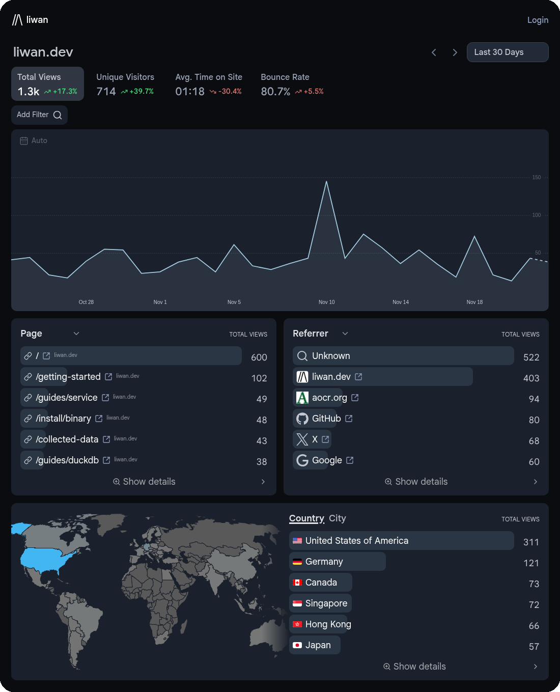
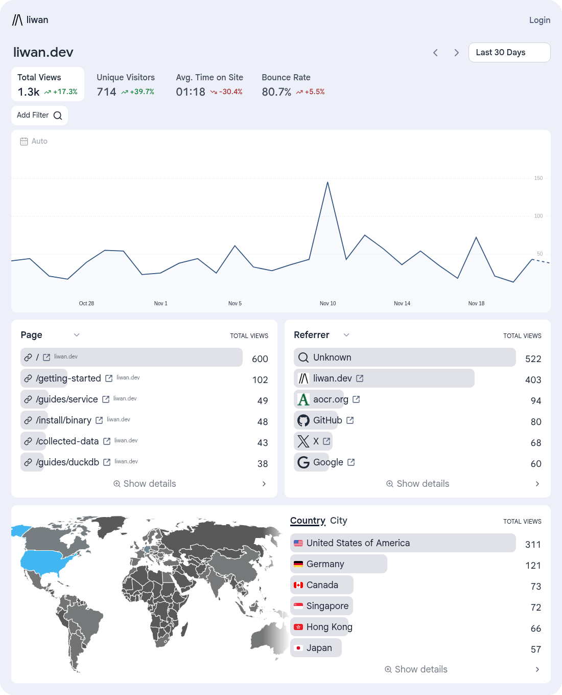

<br/>

<div align="center">
    <h2>
        
        <a href="https://liwan.dev">liwan.dev</a> - Self-hosted, privacy-first web analytics
    </h2>
<div>


[](https://github.com/explodingcamera/liwan/pkgs/container/liwan)

[Live demo](https://demo.liwan.dev/p/liwan.dev) · [Getting started](https://liwan.dev/getting-started/) · [Configuration](https://liwan.dev/reference/configuration/) · [Collected data](https://liwan.dev/collected-data/)

</div>

</div>

<div align="center">
<a href="https://demo.liwan.dev/p/liwan.dev"></a>&nbsp;&nbsp;&nbsp;
<a href="https://demo.liwan.dev/p/liwan.dev"></a>
</div>

## Features

**Understand your traffic**\
See your most-visited pages, where visitors come from, and how traffic changes over time. The dashboard updates in real time, with bot filtering enabled by default. Administrators can put the projects they follow first, and the home page follows that order.

**See where visitors drop off**\
Build funnels from pages and custom events and see how many visitor groups reach each step. Administrators define funnels per project, and anyone who can view the project sees the results for the selected date range and filters. Funnel counts are visitor groups, which reset once a day.

**Easy to self-host**\
Run Liwan as a [single binary](https://liwan.dev/install/binary/) or [Docker container](https://liwan.dev/install/docker/). The dashboard and database are built in, with no additional services to manage.

**Privacy first**\
No tracking cookies or cross-site tracking. Your analytics data stays on your server, and raw IP addresses aren't recorded.
[Read more about data collection](https://liwan.dev/collected-data/).

**Collect only what you need**\
Choose what data to collect and how long to keep it. Location detail is adjustable, and campaign attribution and session metrics can be disabled independently.

**Campaign links**\
Save the UTM-tagged links you use for a campaign in a project and see the pageviews and unique visitors each one brought in for the selected range. Open the report filtered to that tag in one click.

**Lightweight tracking**\
Add a small browser script with one line of HTML, or send events entirely from your server. Use either approach with any framework or CMS.

**Single sign-on**\
Set up teams and manage accounts with Google Workspaces, Microsoft Entra, or your own OpenID Connect provider like Keycloak or Dex.

## Upgrading

Liwan stores events in DuckDB 2.0. Databases created by earlier versions keep
working without changes; they are only rewritten into the new storage format
when you ask for it.

To rewrite one, stop Liwan and run:

```sh
liwan --config /path/to/liwan.config.toml upgrade-duckdb
```

Pass a database path instead to upgrade a file elsewhere:

```sh
liwan upgrade-duckdb /path/to/liwan-events.duckdb
```

The command writes the converted database next to the original, checks it, and
keeps the original beside it with an `.old` suffix (`liwan-events.duckdb.old`
for the default database). It needs free disk space for a second copy of the
database, and it fails if the database is in use or has an uncommitted
write-ahead log. The conversion is one-way: a converted database cannot be
opened by Liwan releases that bundle DuckDB 1.x.

On a database with 7.1 million events spanning a year, converting an old-format
copy left the file at about the same size (337.5 MiB became 338.0 MiB) and
report times unchanged beyond normal run-to-run variation. The command reads
every row of the converted database back before it replaces the original, and
prints both file sizes.

## License

Unless otherwise noted, this repository is licensed under the [Apache License, Version 2.0](LICENSE.md).

Unless you explicitly state otherwise, any contribution intentionally submitted for inclusion in Liwan by you, as defined in the Apache-2.0 license, shall be licensed under Apache-2.0, without any additional terms or conditions.
